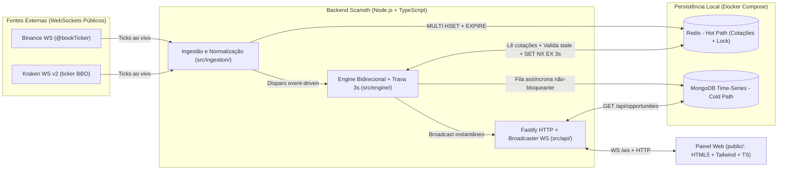

# Scarioth — Cross-Exchange Scanner & Arbitrage Engine

> Scanner em tempo real de cotações e spreads entre **Binance** e **Kraken** construído com **Node.js, TypeScript, Redis, MongoDB Time-Series, Fastify e WebSockets**.

---

## 1. Visão Geral

Em mercados distribuídos como o de criptoativos, o mesmo par (ex.: `BTC/USDT`) é negociado simultaneamente em corretoras independentes. Por instantes, o menor preço de venda (*Ask*) em uma corretora pode ficar abaixo do maior preço de compra (*Bid*) na outra.

O **Scarioth** automatiza o monitoramento contínuo dos fluxos públicos da **Binance** e da **Kraken** para `BTC/USDT`, `ETH/USDT` e `SOL/USDT`, separando o processamento de baixa latência em memória (**Hot Path** no Redis) da persistência histórica em séries temporais (**Cold Path** no MongoDB) e transmitindo tudo ao vivo para um painel web.

---

## 2. Escopo Educacional e Limitações Explícitas

> **Hard Constraint:** O Scarioth é um projeto estritamente **educacional e de observabilidade**. Ele **NÃO executa ordens reais**, não usa chaves privadas de API e **não é um robô de trading**.

Um spread positivo exibido na tela **não significa lucro real garantido**. O modelo da V1 desconsidera intencionalmente os seguintes fatores do mercado real:

1. **Taxas de Corretagem (*Trading Fees*):** Corretoras cobram taxas por execução (frequentemente ~0,1% por lado em ordens a mercado, totalizando ~0,2% ida e volta dependendo da conta e corretora). Um spread bruto menor que a soma das taxas gera prejuízo líquido.
2. **Latência de Rede e Execução:** Entre o instante em que o tick é recebido, comparado no backend e uma eventual ordem retornaria à exchange, milissegundos se passam e o preço pode já ter mudado.
3. **Profundidade do Livro (*Order Book Depth*):** O scanner lê apenas o topo do livro (melhor `Ask` e melhor `Bid`), sem validar quanto volume está disponível naquele preço.
4. **Slippage (Derrapagem):** Ordens maiores do que a liquidez do topo do livro consomem níveis piores de preço, reduzindo ou invertendo o spread calculado.
5. **Capital Pré-Alocado e Rebalanceamento:** Arbitragem real exige saldo previamente posicionado nas duas corretoras ou custos e tempo de transferência na blockchain para rebalanceamento.

---

## 3. Arquitetura e Fluxo de Dados



### Pilares Arquiteturais
- **Hot Path em Memória (Redis):** Cotações normalizadas são gravadas atomicamente (`MULTI` + `HSET` + `EXPIRE`) com `updatedAt` do relógio local de recebimento. A proteção contra **Stale Data** impede comparar cotações quando uma corretora fica muda além de `MAX_TICK_AGE_MS`.
- **Cálculo Bidirecional + Trava Atômica:** A Engine avalia os dois sentidos (`Binance -> Kraken` e `Kraken -> Binance`) e usa `SET key 1 EX 3 NX` no Redis por par + direção (`lock:arbitrage:<PAIR>:<BUY>:<SELL>`) para impedir alertas duplicados sem race conditions.
- **Cold Path Não-Bloqueante (MongoDB Time-Series):** A coleção `arbitrage_opportunities` nasce nativamente como **Time-Series** (`timeField: "timestamp"`, `metaField: "pair"`, `granularity: "seconds"`). O `AsyncOpportunityWriter` grava em segundo plano com *backpressure* (`maxPending`) e tratamento seguro de erros para nunca travar nem derrubar a ingestão.
- **Resiliência de WebSockets:** Conexão combinada `@bookTicker` na Binance (`ping`/`pong` + reciclagem preventiva < 24h) e canal `ticker` com `event_trigger: "bbo"` na Kraken WebSocket API v2, ambos com *watchdog* e reconexão via *backoff exponencial com jitter*.

---

## 4. Stack e Decisões Técnicas (ADRs)

| Camada | Escolha | Papel no Projeto |
| :--- | :--- | :--- |
| **Runtime & Linguagem** | Node.js (v20+) + TypeScript | Execução assíncrona orientada a eventos com tipagem estática estrita. |
| **Configuração** | `dotenv` + `zod` | Validação *fail-fast* na inicialização em `src/config/`. |
| **Ingestão WS** | `ws` | Cliente WebSocket leve para Binance e Kraken v2 + servidor `/ws` do painel (**ADR-03**). |
| **Hot Path / Lock** | Redis + `ioredis` | Armazenamento de cotações atuais e lock atômico `SET NX EX`. |
| **Cold Path** | MongoDB 7 + driver oficial `mongodb` | Coleção nativa Time-Series sem overhead de ODM (**ADR-02**). |
| **API HTTP** | Fastify + `@fastify/cors` + `@fastify/static` | `GET /api/opportunities`, `GET /health` e arquivos do painel (**ADR-01**). |
| **Front-end** | HTML5 + Tailwind CSS v4 + TS (`esbuild`) | Dashboard em tempo real com histórico, filtros e reconexão automática (**AUD-04**). |
| **Logs & Testes** | Pino + Vitest | Logs JSON estruturados (**ADR-06**) + testes unitários e de integração (**ADR-05**). |

Detalhes completos das decisões e especificações verificadas das exchanges estão em [`docs/ADRS.md`](docs/ADRS.md) e [`docs/SCARIOTH_OVERVIEW.md`](docs/SCARIOTH_OVERVIEW.md).

---

## 5. Estrutura de Pastas

```text
Scarioth/
├── client/                  # Código-fonte TypeScript e CSS Tailwind do painel web
├── docs/                    # Documentação arquitetural e ADRs
├── public/                  # HTML base e assets compilados (app.js / styles.css ignorados no Git)
├── src/
│   ├── api/                 # Servidor Fastify, WebSocket Broadcaster e Health Check
│   ├── config/              # Validação fail-fast de .env e logger Pino
│   ├── database/            # Conexão MongoDB, criação Time-Series e escritor assíncrono
│   ├── engine/              # Cálculo bidirecional de spread e orquestrador da Engine
│   ├── ingestion/           # Conectores Binance/Kraken v2, normalizador, stale check e backoff
│   ├── redis/               # Cliente ioredis, repositório de ticks e trava atômica
│   ├── scripts/             # Smoke tests dedicados por etapa (db, ingestion, engine, persistence, api)
│   ├── types/               # Contratos TypeScript compartilhados do domínio
│   ├── shutdown.ts          # Coordenador idempotente de Graceful Shutdown
│   └── index.ts             # Ponto de entrada da aplicação
├── tests/
│   ├── integration/         # Testes de integração contra Redis e MongoDB reais
│   └── *.test.ts            # Testes unitários isolados
├── .env.example             # Modelo de variáveis de ambiente
├── docker-compose.yml       # Redis (redis:7.4-alpine) e MongoDB (mongo:7.0) com healthchecks
├── package.json
├── tsconfig.client.json
├── tsconfig.json
├── vitest.config.ts
└── vitest.integration.config.ts
```

---

## 6. Como Rodar Localmente

### Pré-requisitos
- **Node.js v20+**
- **Docker Desktop** (para subir Redis e MongoDB com as versões fixadas)

### Passo a passo
1. Clone o repositório e entre na pasta:
   ```bash
   git clone git@github.com:brunopimenta67/Scarioth.git
   cd Scarioth
   ```
2. Copie o modelo de variáveis de ambiente:
   ```bash
   cp .env.example .env
   ```
   *(No Windows PowerShell: `Copy-Item .env.example .env`)*
3. Instale as dependências:
   ```bash
   npm install
   ```
4. Suba o Redis e o MongoDB via Docker Compose e aguarde ficarem `healthy`:
   ```bash
   docker compose up -d
   docker compose ps
   ```
5. Compile o painel e inicie o scanner completo:
   ```bash
   npm run start:dev
   ```
   > **Nota para Windows PowerShell:** Se a ExecutionPolicy bloquear `npm.ps1`, use `npm.cmd` no lugar de `npm` (ex.: `npm.cmd run start:dev`).

### Endpoints e Ferramentas Úteis
- **Painel Web em tempo real:** `http://127.0.0.1:3000`
- **Histórico de oportunidades:** `http://127.0.0.1:3000/api/opportunities` (suporta `?pair=BTCUSDT&limit=50`)
- **Health Check:** `http://127.0.0.1:3000/health`
- **WebSocket do painel:** `ws://127.0.0.1:3000/ws`
- **Inspeção visual local:** MongoDB Compass (`mongodb://127.0.0.1:27017` -> banco `scarioth`) e Redis Insight (`127.0.0.1:6379`)

---

## 7. Scripts Disponíveis (`package.json`)

| Script | O que faz |
| :--- | :--- |
| `npm run dev` | Compila o front-end e inicia o backend em modo watch (`tsx watch`). |
| `npm run start:dev` | Compila o front-end e inicia o backend em desenvolvimento (`tsx`). |
| `npm run build` | Compila backend TypeScript (`dist/`) e bundle/CSS do painel (`public/`). |
| `npm run build:client` | Gera `public/app.js` (via `esbuild`) e `public/styles.css` (via Tailwind CLI). |
| `npm run start` | Executa o backend compilado (`node dist/index.js`). |
| `npm run typecheck` | Valida tipos estritos do backend (`tsconfig.json`) e do cliente (`tsconfig.client.json`). |
| `npm run test` | Roda toda a suíte de testes unitários offline (Vitest). |
| `npm run test:integration` | Roda os testes de integração contra Redis e MongoDB reais no Docker. |
| `npm run smoke:db` | Valida conexão Redis + criação idempotente da coleção Time-Series no MongoDB. |
| `npm run smoke:ingestion` | Valida ingestão ao vivo de Binance + Kraken v2 no Redis, *stale check* e reconexão. |
| `npm run smoke:engine` | Valida concorrência atômica do lock no Redis + avaliação ao vivo da Engine. |
| `npm run smoke:persistence` | Valida gravação assíncrona, índices, consulta e tolerância a falhas no MongoDB. |
| `npm run smoke:api` | Valida rotas HTTP (`/health`, `/api/opportunities`, assets) e broadcast `/ws` ao vivo. |

---

## 8. Qualidade e Observabilidade

- **Logs Estruturados (Pino):** Em desenvolvimento usa `pino-pretty` colorido e legível; em produção (`NODE_ENV=production` ou `LOG_FORMAT=json`) emite JSON estruturado com `component`, `exchange`, `pair` e sem inundar o *Hot Path* com logs por tick.
- **Health Checks (`GET /health`):** Verifica ativamente conectividade com Redis e MongoDB (`ping`), frescor das corretoras e estatísticas da Engine e do *Cold Path* (`ok` / `degraded` / `down`).
- **Graceful Shutdown:** Intercepta `SIGINT`, `SIGTERM`, `uncaughtException` e `unhandledRejection` de forma idempotente, parando timers e ingestão, fechando servidor HTTP/WS, esvaziando gravações em voo no MongoDB (`flush`) e encerrando Redis/MongoDB com timeout de segurança.
