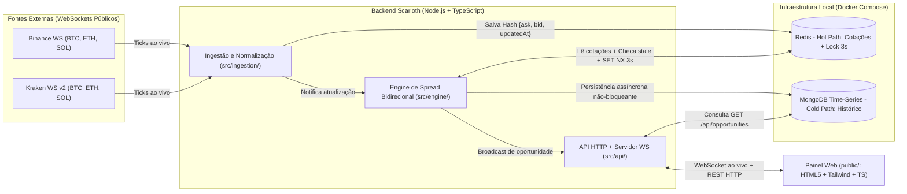

# Scarioth — Documento de Referência Técnica e Arquitetural

> **Status do Projeto:** Etapa 1 em andamento (Setup, Infraestrutura Local e Configuração Fail-Fast).  
> **Finalidade:** Guia de estudo prático (ancorado no ecossistema Java) e base de documentação oficial de portfólio.

---

## 1. Visão Geral e Propósito

### Propósito do Scarioth
O **Scarioth** (*Cross-Exchange Scanner & Arbitrage Engine*) é uma engine de monitoramento de mercado em tempo real desenvolvida em **Node.js, TypeScript, Redis e MongoDB**. O sistema mantém conexões WebSocket contínuas com duas corretoras públicas de criptomoedas (**Binance** e **Kraken**), armazena as cotações mais recentes em memória de ultra baixa latência, calcula diferenças favoráveis de preço (**spreads**) nos dois sentidos e persiste historicamente apenas oportunidades relevantes, exibindo tudo ao vivo em um painel web.

### Problema Resolvido
Como criptoativos são negociados simultaneamente em corretoras independentes, o mesmo par (como `BTC/USDT`) pode apresentar por breves instantes um preço de venda (*Ask*) menor em uma corretora do que o preço de compra (*Bid*) na outra. Detectar essas janelas manualmente é inviável pela velocidade das atualizações. O Scarioth resolve o desafio técnico de **ingerir múltiplos fluxos em tempo real**, **normalizar formatos heterogêneos**, **comparar preços com proteção contra dados defasados**, **evitar alertas duplicados** e **armazenar séries temporais para análise posterior**.

### Escopo Educacional (Por que NÃO é um Robô de Trading)
Por restrição rígida de escopo, o Scarioth **apenas identifica, registra e transmite oportunidades**. Ele **não** utiliza credenciais privadas de corretoras, **não** acessa saldos financeiros e **não** envia ordens de compra ou venda. Essa fronteira protege o projeto contra riscos financeiros e regulatórios, permitindo concentrar o aprendizado em padrões avançados de engenharia backend e sistemas distribuídos.

### Limitações Explícitas do Modelo
Um spread positivo calculado apenas sobre o melhor preço visível de cada corretora **não equivale a lucro líquido real**. As principais limitações ignoradas intencionalmente na V1 são:
- **Taxas de Corretagem:** Corretoras cobram taxas por operação (frequentemente na casa de ~0,1% por lado para ordens a mercado, totalizando ~0,2% ida e volta — valores exatos dependem da corretora e faixa de volume). Spreads abaixo da soma das taxas resultariam em prejuízo.
- **Latência de Rede e Processamento:** Entre a formação do preço na corretora, o tráfego até o servidor do scanner e o retorno de uma eventual ordem, o preço pode mudar antes da execução.
- **Profundidade do Livro de Ofertas (*Order Book Depth*):** O scanner analisa apenas o topo do livro (melhor `Ask` e melhor `Bid`), sem avaliar o volume disponível naquela faixa de preço (que pode ser ínfimo, ex.: \$5).
- **Slippage (Derrapagem):** Em ordens maiores que a liquidez do topo do livro, a execução consome níveis piores de preço, corroendo ou revertendo o spread calculado.
- **Capital Pré-Alocado e Rebalanceamento:** Arbitragem real entre corretoras exige saldo pré-posicionado em ambas as plataformas ou custos e atrasos de transferência on-chain.

---

## 2. Arquitetura e Fluxo de Dados

O Scarioth separa explicitamente o **Hot Path** (caminho crítico em memória RAM, otimizado para baixa latência) do **Cold Path** (gravação durável em disco para histórico, executada sem bloquear o processamento em tempo real).

### Diagrama de Arquitetura e Fluxo

### Etapas do Fluxo de Dados
1. **Ingestão (`src/ingestion/`):** Conectores dedicados escutam os WebSockets públicos da Binance (`@bookTicker`) e da Kraken v2 (`ticker` com `event_trigger: "bbo"`) para `BTC/USDT`, `ETH/USDT` e `SOL/USDT`, convertem os símbolos e preços para o contrato canônico (`BTCUSDT`, `ETHUSDT`, `SOLUSDT`) e tratam reconexões automaticamente.
2. **Hot Path no Redis (`src/redis/`):** Cada cotação validada é gravada como Hash no Redis (ex.: `ticker:binance:BTCUSDT` e `ticker:kraken:BTCUSDT`) contendo `{ ask, bid, updatedAt }`, com TTL defensivo.
3. **Engine de Spread e Deduplicação (`src/engine/`):**
   - Recupera o par de cotações das duas corretoras e descarta comparações se alguma estiver defasada (*stale data*).
   - Calcula o spread nos **dois sentidos** (`Binance -> Kraken` e `Kraken -> Binance`) pela fórmula:
     $$\text{Spread (\%)} = \left(\frac{\text{Bid}_{\text{venda}} - \text{Ask}_{\text{compra}}}{\text{Ask}_{\text{compra}}}\right) \times 100$$
   - Se o spread superar o limiar configurado (`MIN_SPREAD_PERCENTAGE`), tenta adquirir a trava atômica de 3 segundos no Redis (`SET ... NX` com TTL na chave `lock:arbitrage:<PAIR>:<BUY_EXCHANGE>:<SELL_EXCHANGE>`). Apenas a chamada vencedora prossegue.
4. **Cold Path no MongoDB (`src/database/`):** A oportunidade aprovada é gravada de forma assíncrona e não-bloqueante na coleção Time-Series `arbitrage_opportunities` (`timestamp`, `pair`, `buyExchange`, `sellExchange`, `buyPrice`, `sellPrice`, `spreadAbsolute`, `spreadPercentage`), com captura segura de eventuais falhas de disco.
5. **Broadcast e Painel (`src/api/` e `public/`):** A oportunidade é enviada instantaneamente via WebSocket a todos os navegadores conectados, enquanto o histórico e filtros são servidos por `GET /api/opportunities`.

### Mapa de Responsabilidades dos Diretórios

| Diretório / Arquivo | Responsabilidade |
| :--- | :--- |
| `src/config/` | Leitura do `.env`, validação *fail-fast* com Zod e tipagem de configurações. |
| `src/types/` | Contratos e interfaces TypeScript compartilhados entre ingestão, Redis, Engine, banco e API. |
| `src/ingestion/` | Conectores WebSocket da Binance e da Kraken, normalização de símbolos/mensagens, heartbeat e backoff. |
| `src/redis/` | Conexão `ioredis`, gravação/leitura dos hashes de cotação e aquisição de trava atômica com TTL. |
| `src/engine/` | Cálculo puro bidirecional de spread, validação contra *stale data* e orquestração da deduplicação. |
| `src/database/` | Conexão MongoDB, criação idempotente da coleção Time-Series, persistência não-bloqueante e consultas de histórico. |
| `src/api/` | Servidor HTTP Fastify (`GET /api/opportunities`, `GET /health`), arquivos estáticos e broadcast WebSocket (`ws`). |
| `src/index.ts` | Ponto de entrada: instancia e conecta todos os módulos na ordem correta e coordena o *graceful shutdown*. |
| `public/` | Dashboard web em tempo real (HTML5, Tailwind CSS e cliente TypeScript compilado via `esbuild`). |
| `tests/` | Testes unitários (Engine, normalização, stale data) e testes de integração (lock no Redis e rotas HTTP) com `Vitest`. |
| `docs/` | Documentação arquitetural (`SCARIOTH_OVERVIEW.md`, `ADRS.md`). |
| `docker-compose.yml` | Definição declarativa de Redis e MongoDB com tags fixadas, volume persistente e healthchecks. |
| `package.json` / `tsconfig.json` | Gestão de dependências/scripts (análogo ao `pom.xml`) e regras do compilador TypeScript. |
| `.env` / `.env.example` | Variáveis locais privadas (ignoradas no Git) e modelo documentado versionado no repositório. |

---

## 3. Catálogo Completo de Tecnologias e Ferramentas

| Tecnologia / Ferramenta | O que é (1 frase) | Por que foi escolhida e papel no Scarioth | Status | Analogia em Java |
| :--- | :--- | :--- | :---: | :--- |
| **Node.js (v20+ / v24)** | Runtime JavaScript no servidor baseado em *Event Loop* assíncrono com I/O não-bloqueante. | Excelente eficiência para manter múltiplas conexões WebSocket simultâneas com baixa latência e baixo consumo de memória. | **Definida** | **JVM** (com *Event Loop* single-thread de I/O em vez de thread por requisição do Tomcat tradicional). |
| **TypeScript** | Superconjunto do JavaScript que adiciona tipagem estática verificada em tempo de compilação. | Garante contratos claros entre camadas, reduz erros em produção e facilita a transição de quem já programa em Java. | **Definida** | **Sistema de tipos do Java** (interfaces, generics, enums — removidos após compilação para JS). |
| **`tsx`** | Executor rápido de arquivos TypeScript para Node.js baseado em `esbuild`. | Permite executar e recarregar o backend em desenvolvimento sem compilação manual prévia para `dist/`. | **Definida** | Execução direta com reload rápido (semelhante a **Spring Boot DevTools** sem gerar `.jar` manualmente). |
| **`dotenv` + `zod`** | `dotenv` carrega variáveis de `.env` para `process.env`; `zod` valida e tipa schemas em tempo de execução. | Implementam a configuração *fail-fast* em `src/config/`, impedindo que a aplicação suba com variáveis ausentes ou inválidas. | **Definida** | **`application.properties`** + **`@ConfigurationProperties` com Bean Validation**. |
| **`ws`** | Biblioteca leve de cliente e servidor WebSocket padrão para Node.js. | Conecta a ingestão à Binance/Kraken e atua como servidor WebSocket do painel sem camada proprietária extra (ADR-03). | **Definida** | **Jakarta WebSocket API** ou cliente WebSocket do `java.net.http.HttpClient`. |
| **Redis** | Banco de dados em memória RAM de altíssima velocidade focado em chave-valor, hashes e expiração automática. | Compõe o **Hot Path**: guarda o preço mais recente por exchange/par e executa a trava atômica de 3 segundos. | **Definida** | **`ConcurrentHashMap` distribuído em memória com TTL nativo** (ou Redis via Spring Cache). |
| **`ioredis`** | Cliente Redis completo para Node.js com suporte forte a TypeScript e reconexão automática. | Faz a ponte entre o backend TypeScript e o Redis para gravar hashes e executar comandos atômicos (`SET NX`). | **Definida** | **Lettuce** ou **Jedis**. |
| **MongoDB + Time-Series** | Banco orientado a documentos JSON (BSON) com coleções especializadas em séries temporais indexadas por tempo. | Compõe o **Cold Path**: persiste o histórico `arbitrage_opportunities` com compressão eficiente e leitura rápida por período. | **Definida** | **MongoDB** (via Mongo Java Driver); em SQL exigiria extensão como TimescaleDB. |
| **Driver oficial `mongodb`** | Driver oficial da MongoDB para Node.js que comunica-se diretamente com o banco sem ODM. | Escolhido na ADR-02 por eliminar atritos de criação nativa da coleção Time-Series e reduzir overhead no *Cold Path*. | **Definida (ADR-02)** | **JDBC / `MongoClient` nativo** (enquanto Mongoose seria equivalente ao Hibernate/JPA). |
| **Fastify** | Framework web de alta performance e baixa sobrecarga para Node.js com foco em tipagem e async/await. | Escolhido na ADR-01 para servir a API REST (`GET /api/opportunities`, `GET /health`) e arquivos estáticos com integração nativa ao Pino. | **Definida (ADR-01)** | **Javalin / SparkJava / Spring Web** (camada de rotas HTTP). |
| **Docker & Docker Compose** | Plataforma de containers isolados e ferramenta declarativa para orquestrar serviços via YAML. | Subirão Redis (`redis:7.4-alpine`) e MongoDB (`mongo:7.0`) com versões fixadas, volume persistente e healthchecks. | **Definida** | Mesmo **Docker / Docker Compose** usado no ecossistema Java. |
| **Git (e `.gitignore`)** | Sistema distribuído de controle de versão de código-fonte. | Registra evolução por etapa, protege segredos (`.env`) e ignora artefatos pesados (`node_modules`, `dist`). | **Definida** | Mesmo **Git** (excluindo `target/`/`build/` em Java). |
| **HTML5 + Tailwind CSS + TS (`esbuild`)** | Base web unindo marcação semântica, estilização por classes utilitárias e scripts tipados compilados para o navegador. | Entrega um dashboard responsivo, claro e profissional em tempo real dentro de `public/`. | **Definida (AUD-04)** | Front-end web desacoplado consumindo REST/WS de um backend Java. |
| **MongoDB Compass & Redis Insight** | Interfaces gráficas oficiais para explorar documentos no MongoDB e chaves/hashes/TTLs no Redis. | Ferramentas de inspeção visual obrigatórias nos checkpoints para confirmar Time-Series, ticks ao vivo e expiração de travas. | **Definida** | **DBeaver / pgAdmin** (para bancos relacionais). |
| **Vitest** | Framework moderno de testes automatizados com suporte nativo rápido a TypeScript e ESM. | Escolhido na ADR-05 para testar unitariamente a Engine, normalização e stale data (`P1`) e integração (`P2`). | **Definida (ADR-05)** | **JUnit 5** (+ Mockito). |
| **Pino** | Logger estruturado de baixíssimo overhead que emite logs nativamente em formato JSON. | Escolhido na ADR-06 para substituir `console.log` com contexto estruturado sem onerar o *Hot Path*. | **Definida (ADR-06)** | **SLF4J + Logback / Log4j2** com saída JSON. |

---

## 4. Conceitos de Domínio e Engenharia Utilizados

### Glossário de Mercado Financeiro
- **Ask (Preço de Oferta):** Menor preço pelo qual vendedores oferecem o ativo no momento — é o preço pago por quem deseja **comprar** imediatamente.
- **Bid (Preço de Demanda):** Maior preço que compradores oferecem pelo ativo no momento — é o preço recebido por quem deseja **vender** imediatamente.
- **Spread:** Diferença positiva entre o `Bid` na corretora de venda e o `Ask` na corretora de compra, medido em valor absoluto (`Bid - Ask`) e em percentual relativo ao preço de compra.
- **Arbitragem Bidirecional:** Avaliação simultânea das duas pontas (`Binance -> Kraken` e `Kraken -> Binance`), permitindo detectar oportunidades independentemente de qual corretora estiver momentaneamente mais barata.
- **Order Book (Livro de Ofertas):** Lista ordenada de todas as ofertas abertas de compra e venda com seus respectivos preços e volumes disponíveis em uma corretora.
- **Slippage (Derrapagem):** Diferença entre o preço esperado no topo do livro e o preço médio efetivamente obtido quando o volume da ordem excede a liquidez imediata.

### Glossário de Engenharia Backend e Sistemas Distribuídos
- **Event Loop:** Laço central do Node.js que coordena callbacks e `Promises` em uma thread principal enquanto delega I/O de rede e disco ao sistema operacional sem travar a aplicação.
- **WebSocket:** Protocolo de conexão persistente e bidirecional sobre TCP que permite envio instantâneo de dados em tempo real entre servidor e cliente.
- **Hot Path vs. Cold Path:** Separação entre o caminho crítico de baixíssima latência em memória (*Hot Path*: ingestão -> Redis -> Engine) e o caminho secundário de persistência durável em disco (*Cold Path*: MongoDB) que não pode atrasar o primeiro.
- **Coleção Time-Series:** Tipo especial de coleção no MongoDB projetada para registros cronológicos imutáveis (`timeField` + `metaField`), otimizando armazenamento e consultas por janelas de tempo.
- **Stale Data (Dados Defasados):** Cotação armazenada em memória cuja última atualização (`updatedAt`) ultrapassou a idade máxima permitida, devendo ser ignorada para impedir spreads falsos quando uma fonte para de responder.
- **Trava Atômica (`SET NX` + TTL):** Operação única e indivisível no Redis que cria uma chave temporária apenas se ela ainda não existir, impedindo condições de corrida (*race conditions*) típicas de abordagens "ler e depois gravar".
- **Heartbeat (Ping/Pong) e Backoff Exponencial:** *Heartbeat* é a verificação periódica de que uma conexão WebSocket continua viva; *Backoff Exponencial* é a pausa progressivamente maior entre tentativas de reconexão após uma queda (idealmente com aleatoriedade *jitter*) para evitar sobrecarregar a exchange.
- **Fail-Fast (Falha Rápida):** Prática de validar pré-condições obrigatórias logo no início da execução e encerrar imediatamente com erro claro caso algo essencial falte, evitando falhas tardias e silenciosas.
- **Persistência Assíncrona (Não-Bloqueante):** Disparo da escrita em banco fora do bloqueio direto do fluxo de ingestão/cálculo, sempre acompanhado de tratamento de erros para evitar quedas por promessas rejeitadas não tratadas.
- **Health Checks:** Endpoints HTTP (como `GET /health`) que inspecionam e reportam a saúde da aplicação e de suas dependências críticas (Redis, MongoDB e exchanges).
- **Graceful Shutdown (Desligamento Gracioso):** Encerramento coordenado ao receber sinais do sistema operacional (`SIGINT`/`SIGTERM`), finalizando WebSockets, timers, servidor HTTP e conexões de banco de forma ordenada antes de encerrar o processo.

---

## 5. Decisões de Engenharia e Qualidade

### Resumo dos 12 Invariantes Adotados
1. Separação rigorosa entre setup de ambiente (Etapa 1) e testes de conexão de bancos (Etapa 2).
2. Higiene de repositório (`.gitignore` protegendo `node_modules`, `dist` e `.env`) antes de instalar dependências.
3. Configuração *fail-fast* validada e tipada em `src/config/`.
4. Versões Docker explicitamente fixadas (nunca `:latest`), com volume persistente no MongoDB.
5. Coleção `arbitrage_opportunities` criada nativamente como Time-Series e validada visualmente antes de qualquer uso.
6. Cálculo de spread estritamente bidirecional com registro explícito de `buyExchange` e `sellExchange`.
7. Normalização de símbolos entre corretoras para um formato canônico único.
8. Proteção ativa contra *stale data* com base em `updatedAt`.
9. Deduplicação exclusiva por trava atômica (`SET NX` + TTL de 3s) no Redis.
10. Conectores WebSocket resilientes com heartbeat e reconexão automática com backoff.
11. Gravação assíncrona não-bloqueante no MongoDB com tratamento explícito de falhas.
12. Transparência no `README.md` sobre as limitações reais de mercado, acompanhada de diagrama arquitetural, testes e logs estruturados.

### Estratégia de Validação por Checkpoints
O projeto avança uma etapa por vez com **portões de validação (*Human-in-the-Loop Gates*)**. Nenhuma nova camada é empilhada antes de verificar evidências concretas da camada anterior (containers saudáveis, chaves em atualização no Redis Insight, coleção Time-Series confirmada no MongoDB Compass, testes unitários passando e broadcast visível no painel).

### Valor Arquitetural para Portfólio
Para um estudante migrando de Java para Node.js/TypeScript, o Scarioth vai muito além de um CRUD tradicional ao comprovar domínio prático de **streaming de dados em tempo real**, **persistência poliglota intencional** (Redis + MongoDB Time-Series), **controle atômico de concorrência**, **tratamento real de falhas de rede/banco** e **honestidade técnica sobre trade-offs de domínio**.
